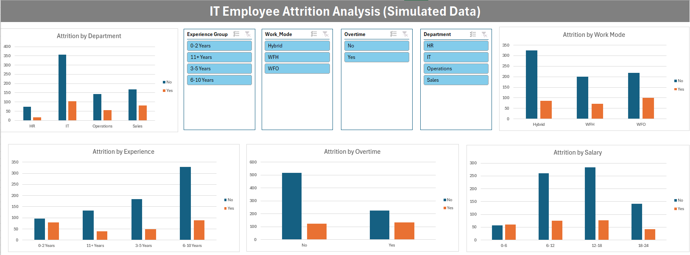

# IT Employee Attrition Analysis (Simulated Data)

This is a practice project where I looked at which employees are more likely to leave a company. I used 1,000 IT employee records and worked with Python, SQL (SQL Server), Excel and Power BI.

> **Note:** The data is **simulated (not real)**. I generated it with Python (`PYTHON/IT_Employee_Attrition_Data_Generation.ipynb`) using rules that I wrote myself. So the results are **not from a real company** and do not show real employee behaviour. I made this project only to practice the full analysis steps.

---

## Dashboards

**Power BI**


**Excel**



---

## What I Wanted to Do

- Make a dataset about employees and whether they left (attrition).
- Use SQL to find which groups leave the most: salary, overtime, experience, department and work mode.
- Check the same things in Python with simple charts.
- Make a dashboard in Excel and in Power BI.

## Tools Used

| Tool | Used for |
| --- | --- |
| Python (Pandas, NumPy, Matplotlib) | Making the data, checking it, attrition charts |
| SQL Server | Creating the table and 5 queries (CASE, GROUP BY) |
| Excel | Pivot tables, pivot charts, 4 slicers, dashboard |
| Power BI | Dashboard with 4 KPI cards, 2 charts and 2 filters |

## Project Structure

```text
IT-Employee-Attrition-Analysis/
├── DATA/
│   └── it_employee_attrition_dataset.csv
├── PYTHON/
│   ├── IT_Employee_Attrition_Data_Generation.ipynb
│   └── IT_Employee_Attrition_Analysis.ipynb
├── SQL/
│   ├── Create Database and Table.sql
│   └── Query 1 ... Query 5 (.sql files)
├── EXCEL/
│   ├── IT_Employee_Attrition_Analysis.xlsx
│   └── excel_dashboard.png
├── POWER BI/
│   ├── IT Employee Attrition Dashboard.pbix
│   └── powerbi_dashboard.png
├── IT_Employee_Attrition_Project_Documentation.pdf
└── README.md
```

## Dataset

The file `it_employee_attrition_dataset.csv` has 1,000 rows and 9 columns. There are no missing values and no duplicate rows.

| Column | Meaning |
| --- | --- |
| Employee_ID | Unique ID (1001 to 2000) |
| Department | IT, Sales, HR or Operations |
| Total_Experience_Years | Experience in years (1 to 12) |
| Salary_LPA | Salary in lakhs per year (3.9 to 21.29) |
| Years_Since_Last_Promotion | 0 to 5 years |
| Work_Mode | WFH, Hybrid or WFO |
| Distance_From_Home_KM | Distance from home (2 to 44 km) |
| Overtime | Yes or No |
| Attrition | Yes if the employee left, No if the employee stayed |

**How I made the data (seed 42):**
- Department, work mode, overtime, experience, promotion years and distance are picked randomly.
- Salary = experience x 1.4 + a random number between 2.5 and 4.5.
- Attrition starts with a 5% chance of leaving. I added extra chance for these cases: salary below 6 LPA (+15%), 3 or more years without promotion (+10%), overtime (+20%), WFO with distance above 25 km (+12%), experience 2 years or less (+15%), Sales department (+5%) and WFO (+5%).
- A random number decides if the employee leaves.

## SQL Queries

All queries run on the database `IT_Employee_Attrition_DB` (table `it_employee_attrition`). In every query I compare the attrition **rate (%)**, not only the count.

| # | Question | Result |
| --- | --- | --- |
| 1 | Attrition by salary bracket | Below 6 LPA: 51.28%, 6-12 LPA: 22.49%, above 12 LPA: 22.20% |
| 2 | Overtime vs attrition | Overtime: 37.15%, no overtime: 19.31% |
| 3 | Attrition by experience | 0-2 years: 45.20%, 3-7 years: 21.05%, 8+ years: 21.93% |
| 4 | Attrition by department | Sales 32.67%, Operations 27.64%, IT 22.56%, HR 17.98% |
| 5 | Attrition by work mode | WFO 31.45%, WFH 26.37%, Hybrid 20.78% |

## What I Found (in the simulated data)

- 257 out of 1,000 employees left, so the attrition rate is 25.7%.
- Employees earning below 6 LPA leave the most (51.3%). The other two salary groups are almost the same (about 22%).
- Employees with 0-2 years of experience leave the most (45.2%). Salary depends on experience in this data, so these two results are connected.
- Overtime nearly doubles attrition (37.2% vs 19.3%).
- Sales has the highest attrition (32.7%) and HR the lowest (18.0%). IT has the most employees leaving (104), but only because IT is the biggest department.
- WFO has the highest attrition (31.5%) and Hybrid the lowest (20.8%).
- Attrition goes up after 4 and 5 years without a promotion (28.5% and 33.9%).
- Distance has only a small effect (28.5% for 31+ km, about 23% to 25% for the others).

## Limitations

- The data is simulated, so all these patterns come from the rules I wrote in the generator. The analysis only confirms them, it does not discover them.
- HR has only 89 employees, so its result is less reliable.
- The Excel dashboard groups experience and salary a little differently from SQL and Python (for example 0-2, 3-5, 6-10 and 11+ years), and its charts show counts, not rates.
- I did not use any statistical tests, only simple counts and percentages.

## What I Learned

- How to make a dataset with random choices and rules in Python.
- How to use CASE and GROUP BY in SQL Server to make groups and find rates.
- Why attrition rate (%) is better than the raw count when groups have different sizes.
- How to make pivot tables, slicers and a dashboard in Excel and Power BI.
- That results from simulated data mostly show the rules I put in it.

## How to Run

1. **Python:** Open the notebooks in Jupyter or Colab (`pip install pandas numpy matplotlib`). The generator saves the file as `it_employee_attrition_data.csv`. The analysis notebook reads `it_employee_attrition_dataset.csv` (the file in `DATA/`), so rename the file or change the name in the notebook.
2. **SQL:** Run `Create Database and Table.sql`, import the CSV into the table `it_employee_attrition`, then run the query files.
3. **Excel / Power BI:** Open the files in the `EXCEL/` and `POWER BI/` folders.

## Author

**Santosh Chaurasia**
M.Sc. Data Science student
